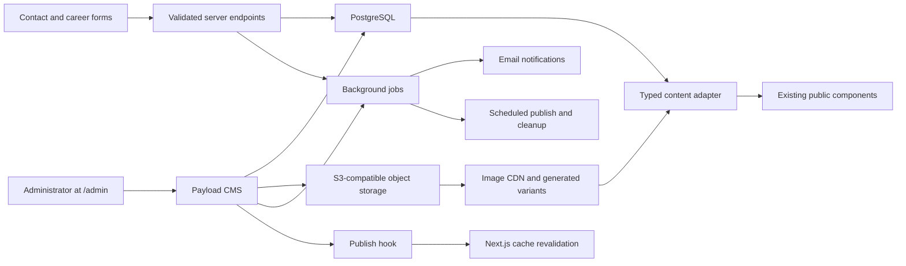

# R.A. Design Studio Admin Panel — Industry Implementation Plan

Status: planning baseline  
Prepared from the current Next.js client in this workspace  
Recommended delivery: Payload CMS + PostgreSQL + object storage/CDN, integrated with the existing Next.js application

## 1. Outcome

Build a secure, production-grade admin panel at `/admin` that makes every public-facing content area dynamic while preserving the approved client-side design and behavior.

The admin must let authorized staff:

- manage projects, images, homepage sections, Studio, Press, Careers, Contact, navigation, footer, SEO, and redirects;
- upload only suitable media, with automatic dimension, aspect-ratio, format, focal-point, and quality checks;
- preview changes at real desktop and mobile breakpoints before publishing;
- use drafts, review, scheduled publishing, version history, and rollback;
- receive and manage contact enquiries and job applications;
- use a single protected administrator account with a complete audit trail.

The public site must remain fast, indexable, visually unchanged, and resilient when the CMS or a third-party notification service is temporarily unavailable.

## 2. Current-state audit

### What exists

- Next.js 15.5 App Router, React 19, TypeScript.
- Public routes: Home, Work, Project Detail, Studio, Press, Careers, and Contact.
- Ten projects with 89 project images.
- 113 files under `public/media`, approximately 96 MB on disk.
- Nine current homepage hero images, all sourced from 2200-pixel-wide project originals.
- Responsive `next/image` rendering through the shared `Media` component.
- Static SEO metadata, sitemap, robots rules, and JSON-LD.
- Type checking currently passes.

### Gaps the admin must solve

- Projects, services, process steps, testimonials, press, and site facts are hard-coded in `lib/projects.ts` and `lib/site.ts`.
- Homepage hero images are hard-coded in `lib/media.ts`.
- Homepage featured work is implicitly the first six built projects, rather than an editorial selection.
- Most project write-ups are explicitly marked as demo copy; years and several facts still need confirmation.
- Studio founder/team images, Press thumbnails, and the Careers cover are placeholders.
- Career roles and the displayed role count are hard-coded.
- The contact form does not send or store data; it only displays a local success state.
- Contact details are duplicated across site settings, Contact, Footer, metadata, and structured data, creating drift risk.
- Project pages are generated from static params; there is no publish-triggered cache invalidation or draft preview.
- Sitemap `lastModified` values are deployment time rather than the content's actual modification date.
- Project structured data currently hard-codes Ahmedabad for project location.
- `JOURNAL` data and the `BigFeatured` component exist but are not rendered on the live route tree; they should not silently expand the P0 admin scope.
- There is no database, authentication, admin authorization, API, upload pipeline, audit history, or notification workflow.
- A spare cover image is only 458×343 pixels. The older carousel folder contains 1080×566 and 1600×400 images and must not be allowed back into a full-screen hero.

### Scope guardrail

“Everything dynamic” means content, media, ordering, visibility, SEO, and publishing are editable. It does not mean editors can change CSS, breakpoints, component code, animations, or invent arbitrary layouts.

Use constrained, schema-driven fields and approved section types. This protects the client-side design that is already accepted.

## 3. Recommended architecture



### Technical decision

- **CMS/admin:** Payload CMS inside the existing Next.js codebase, exposed at `/admin`.
- **Database:** Managed PostgreSQL with versioned production migrations.
- **Media:** S3-compatible object storage with a CDN; no production media stored on the application filesystem.
- **Image processing:** Sharp-backed derivative generation, focal-point crops, WebP/AVIF delivery, and original preservation.
- **Public data access:** Server-side CMS Local API through a small typed adapter layer.
- **Caching:** Tag content by domain (`site-settings`, `home`, `projects`, `project:{slug}`, `press`, `careers`, `studio`). Publish hooks invalidate only affected tags and paths.
- **Preview:** Authenticated Next.js Draft Mode link from every editable document.
- **Background work:** Queue image processing, notifications, scheduled publishing, retention cleanup, and retryable jobs.
- **Email:** Configurable transactional email settings in the admin panel behind
  a provider interface; credentials remain deployment secrets and are never
  editable as normal content.
- **Spam protection:** server-side rate limiting, honeypot, and a privacy-conscious challenge only when risk requires it.
- **Observability:** admin-visible analytics summary, structured logs, uptime
  checks, error monitoring, and alerts for failed jobs/forms.

### Integration principle

Do not rewrite the approved components around CMS response objects. Add `lib/cms` queries and mappers that return the existing frontend view models. This keeps the design stable and makes CMS migration testable.

Suggested boundaries:

```text
app/(payload)/admin/...       Payload admin route group
app/(payload)/api/...         CMS endpoints
cms/collections/...           Projects, Media, Press, Jobs, Enquiries
cms/globals/...               Home, Studio, Careers, Contact, Site Settings
cms/access/...                Single-admin access and field-level safeguards
cms/hooks/...                 Validation, revalidation, redirects, jobs
lib/cms/queries/...           Published and preview reads
lib/cms/mappers/...           CMS record -> existing frontend model
lib/validation/media.ts       Shared media slot requirements
```

## 4. Admin information architecture

### Client-first operating model

The admin panel should feel like a simple studio content desk, not a developer
CMS. The client should be able to complete the common tasks from a small number
of clear actions:

1. **Add project** — enter the project facts, upload a cover, add gallery images,
   write the short description, choose one of the four disciplines, and save a
   draft.
2. **Edit project** — open the project dashboard, see its completion status,
   update copy/media/order, preview desktop and mobile, then publish.
3. **Update homepage** — edit the visible sections in the same order they appear
   on the homepage, with explicit show/hide toggles and drag-to-reorder controls.
4. **Update studio information** — edit founders, team, portraits, bios, roles,
   and ordering without touching project data.
5. **Manage enquiries** — see new enquiries, assign a status, add notes, reply
   through the configured email workflow, and archive when complete.

The dashboard should always answer three questions immediately:

- What needs attention?
- What will change if I publish?
- What is the safest next action?

### Dynamic, but intentionally constrained

“Super dynamic” should mean every approved content field, image, relationship,
order, visibility state, SEO field, and publishing state is editable. It should
not mean the client can freely change CSS, spacing, breakpoints, animations, or
create arbitrary page layouts. The panel should expose a controlled set of
section types that preserve the approved R.A. Design Studio design system.

Every editable section should include:

- a clear plain-language label;
- a short explanation of where it appears on the public site;
- a required/optional indicator;
- a character or image-count guide where useful;
- a live preview link;
- a completion state and actionable validation message;
- draft, preview, publish, schedule, archive, and restore actions where the
  content type supports them.

### Recommended editor experience

#### Dashboard

Show four primary cards:

- **Needs attention** — incomplete projects, invalid media, broken press links,
  expired roles, and failed notifications.
- **Drafts** — content saved but not yet published by the administrator.
- **Recent changes** — who changed what and when.
- **Quick actions** — Add project, Add press item, Add job, Edit homepage, and
  Open enquiries.

Avoid exposing database terms, collection IDs, slugs, raw JSON, or technical
cache controls in the normal editor flow.

#### Project editor

Use a guided four-step editor with a persistent completion indicator:

1. **Basics** — title, discipline, year, location, status, area, and slug.
2. **Story** — lede, body paragraphs, materials, and credits.
3. **Images** — cover, ordered gallery, focal points, captions, alt text, and
   photographer/rights details.
4. **Publish** — desktop/mobile preview, SEO preview, related-project check,
   publish/schedule/archive controls, and a final validation summary.

The editor should autosave drafts and never discard unsaved changes when moving
between steps.

#### Homepage editor

Represent the homepage as a vertical list of approved sections:

```text
Hero
Selected work
Four disciplines
How we work
Press and recognition
Studio CTA
```

Each section gets an Edit, Preview, Hide/Show, and Move action. The editor may
change content and order within approved limits, but cannot create a layout that
the frontend does not support.

#### Media workflow

When selecting an image, show the client:

- a large preview;
- original dimensions and file size;
- where the image is currently used;
- the desktop and mobile crop previews;
- a focal-point picker;
- alt text and credit fields;
- a plain-language warning such as “Too small for a full-screen hero.”

Use “Replace image” and “Archive image” instead of destructive delete. Never let
the client accidentally remove a media asset still used by a published page.

#### Preview and publishing

Every content record should have:

- **Save draft**;
- **Preview**;
- **Send for review**;
- **Publish now**;
- **Schedule publish**;
- **Restore previous version**.

The preview should show the actual public page at desktop and mobile sizes, not
an abstract form preview. Publishing should show a final checklist and a clear
summary of affected public URLs.

#### Single-admin model

The first release has one administrator account. That account can manage all
content and operations:

- projects, media, homepage, Studio, Press, Careers, Contact, and SEO;
- drafts, previews, publishing, scheduling, archiving, and rollback;
- enquiries and career applications;
- email, privacy, analytics, monitoring, and site settings.

There is no multi-user invitation system, role picker, team-permission UI, or
multi-user editor/publisher split in the first release. Protect the single account with a
strong password, optional MFA, login throttling, session expiry, recovery codes,
and a documented emergency recovery process. A future multi-user model can be
added without changing the public content schema.

### Admin design principles

- Use familiar words: “Project”, “Image”, “Publish”, “Archive”, “Restore”.
- Put the public result one click away from every editor screen.
- Prefer guided steps over one very long form.
- Show errors next to the field that needs fixing.
- Explain technical problems in client language.
- Make destructive actions reversible wherever possible.
- Keep the public design system fixed and the editorial content flexible.
- Make the most common tasks possible in under two minutes after sign-in.

| Admin module | Main capabilities | Priority |
|---|---|---|
| Dashboard | Content status, unread enquiries, open roles, failed media/jobs, recent activity, quick actions | P0 |
| Projects | Create/edit/duplicate/archive, galleries, credits, categories, ordering, featured selection, SEO, preview | P0 |
| Homepage | Hero, headings, featured projects, services, process, stats, testimonials, press strip, CTA | P0 |
| Media Library | Upload, validation, focal point, crop previews, alt text, credits, usage, duplicate warning | P0 |
| Studio | Intro, founders, bios, portraits, team roster, roles, order, active/inactive | P0 |
| Press | Publication, article, dates, URL, thumbnail/logo, featured/order, link validation | P0 |
| Careers | Page copy, cover, job roles, opening/closing dates, apply settings, why-work-here copy | P0 |
| Contact | Contact facts, hours, address, coordinates, channels, map, project-type choices, response copy | P0 |
| Enquiries | Inbox, status, assignment, notes, tags, export, spam state, deletion/retention | P0 |
| Applications | Job-linked applications, portfolio/CV, pipeline status, notes, export, retention | P1 |
| Email Delivery | Provider status, sender/reply-to, recipients, templates, test email, delivery failures | P0 |
| Privacy & Legal | Policies, consent copy, effective dates, retention copy, public legal pages | P0 |
| Analytics & Health | Analytics consent/settings, traffic summary, uptime, backups, errors, failed jobs | P0 |
| SEO & Redirects | Defaults, per-page overrides, OG images, canonical settings, redirect history | P0 |
| Admin Account | Password, MFA, recovery, active sessions, security events | P0 |
| Audit & Operations | Change log, versions, rollback, jobs, webhook delivery, system health | P0 |

## 5. Public-page-to-admin mapping

### Home

Make dynamic:

- hero headline and emphasized phrase;
- ordered hero slides, mobile/desktop crop previews, alt/decorative state, focal point;
- establishment year, project/stat values, and labels;
- Selected Work heading, date range, explicit project selection and drag order;
- services eyebrow, heading, intro, service title/description/order;
- process heading, intro, step title/description/order;
- stats and units;
- testimonials, attribution, visibility, order;
- press logo strip and link;
- Studio CTA copy, link labels, and destinations;
- section visibility and approved section order.

Rules:

- Require at least one published hero slide.
- Limit hero slides to a practical editorial maximum, initially 12.
- Featured projects must be published and have a valid cover.
- Counts such as project totals and open positions should be computed unless an explicit override is approved.

The unused `BigFeatured` component should remain disabled until the client explicitly wants that section live.

### Work index

Make dynamic:

- header/lede and SEO;
- project order;
- project visibility;
- project categories used to derive filters;
- optional featured/pinned ordering.

Never allow an empty filter to appear. Category filters are derived only from published projects.

### Project detail

Required project fields:

- title, immutable published slug, type/category, year, location, area, status;
- short lede and structured body content;
- materials/tags;
- credits: studio lead, team, landscape, photographer, collaborators;
- cover image and gallery;
- gallery image order, section, caption, alt text, and optional layout emphasis;
- featured flag and Home/Work order;
- related-project overrides with automatic fallback;
- SEO title/description, canonical URL, OG image, index/no-index;
- draft/published/scheduled/archived state.

Rules:

- Slug changes after first publish automatically create a permanent redirect.
- Published projects require title, slug, category, year, location, lede, cover, at least three gallery images, valid alt text/credits, and SEO preview.
- A gallery image may be reused, but the admin warns on duplicates within one project.
- Related projects cannot reference the same project or unpublished content.
- The project sitemap and JSON-LD use real `updatedAt`, location, image dimensions, and published status.

### Studio

Make dynamic:

- page eyebrow, title, intro paragraphs, and SEO;
- founders' names, titles, biographies, portraits, order;
- team member name, role, portrait, order, active/inactive status;
- section headings.

Team members should be archived rather than deleted so old versions and media usage remain traceable.

### Press

Make dynamic:

- page header/lede and SEO;
- publication records and logos;
- article/award title, publication date, year, type, external URL, thumbnail, featured state;
- chronological/order override.

Validate URLs, open external links safely, and display a clear unpublished/broken-link warning in admin.

### Careers

Make dynamic:

- page header, intro, cover image, section headings, and why-work-here content;
- job title, slug/reference, summary, full description, location, work mode, employment type, experience, status, opening and closing dates;
- application method, recipient/owner, and confirmation copy;
- automatic open-position count.

Job status should be `Draft`, `Scheduled`, `Open`, `Paused`, `Closed`, or `Archived`. Expired roles close automatically but remain available in admin history.

### Contact and global site settings

Use one canonical Site Settings source for:

- studio name/legal name, founding year, phones, emails, WhatsApp, Instagram;
- full postal address, map coordinates, directions URL, opening hours;
- navigation and footer link labels/order;
- footer CTA and copyright;
- global SEO title template, description, keywords, logo, favicon, default OG image;
- organization structured-data fields.

Contact-page-only fields include page copy, enquiry choices, response-time copy, map visibility, and consent/privacy copy.

Changes to a phone number or address must update Contact, Footer, metadata, and JSON-LD together.

### Email delivery settings

Add an **Email** panel inside Site Settings. The single administrator can
configure:

- provider: `SMTP`, `Resend`, `Postmark`, or another supported provider;
- sender name and sender address;
- reply-to address;
- contact-enquiry notification recipients;
- career-application notification recipients;
- whether sender acknowledgement emails are enabled;
- acknowledgement subject and message templates;
- notification subject templates;
- a **Send test email** action and last-delivery status;
- failure alerts and retry status.

Provider API keys, SMTP passwords, and signing secrets must remain deployment
environment secrets. The admin panel should show whether a provider is
configured, but must never display or store raw credentials as editable content.

If email delivery fails, the enquiry/application must still be saved in the
database and appear in the admin inbox.

### Privacy and legal content

Add a **Privacy & Legal** panel and public routes for:

- Privacy Policy;
- Terms of Use, if required by the business;
- enquiry consent text;
- career-application consent text;
- cookie/analytics consent text;
- data-retention summary;
- contact-form confirmation and response-time copy;
- privacy-contact email;
- policy version and effective date.

Legal pages use the same constrained rich-text editor as project copy. The
administrator can draft, preview, publish, schedule, archive, and restore policy
versions. The admin should show a warning when published forms reference an
older policy version. Final legal wording and retention periods require approval
from the client's legal/business owner.

### Analytics and monitoring

Add an **Analytics & Health** panel with two separate concerns:

#### Privacy-conscious analytics

- provider enable/disable toggle;
- provider choice, initially Plausible or Google Analytics;
- measurement ID stored as a deployment secret or protected setting;
- cookie/consent requirement toggle;
- tracked events: project view, category filter, gallery open, enquiry start,
  enquiry submit, WhatsApp click, phone click, directions click, and CV/portfolio
  application start;
- simple dashboard metrics: visitors, top pages, top projects, enquiries,
  conversions, and traffic source when available.

Analytics must be disabled by default until consent requirements and the privacy
policy are approved. Do not store raw personal data in analytics events.

#### System monitoring

Show the administrator:

- public site uptime;
- last successful deployment;
- CMS/database health;
- storage capacity and failed media processing;
- email provider health and failed deliveries;
- failed scheduled publishes;
- last backup and backup verification status;
- error count over the last 24 hours;
- a clear status of `Healthy`, `Warning`, or `Action required`.

Notifications should go to the configured admin email. The public site should
continue serving the last published content if CMS, analytics, or email
services are unavailable.

## 6. Core content model

### Collections

| Collection | Important fields |
|---|---|
| Admin Account | name, email, password state, MFA state, recovery state, active sessions, last login, security events |
| Media | file, width, height, ratio, MIME, size, checksum, perceptual hash, alt, caption, photographer, rights, focal point, validation state, usages |
| Projects | editorial/project fields listed above, relationships, SEO, workflow, timestamps |
| Project Categories | name, slug, order, active |
| Publications | name, logo, website, order, active |
| Press Items | publication, piece title, type, date/year, URL, thumbnail, featured, workflow |
| Team Members | name, role, biography, portrait, order, active/archive |
| Jobs | role details, dates, owner, application settings, workflow |
| Enquiries | submitted fields, source, status, assignee, spam score, consent, notes, timestamps |
| Job Applications | job, applicant data, CV/portfolio, status, assignee, notes, timestamps |
| Redirects | source, destination, code, origin, active, hit metadata |

### Singletons/globals

- Site Settings
- Email Delivery Settings
- Privacy & Legal
- Analytics & Monitoring Settings
- Homepage
- Work Page
- Studio Page
- Press Page
- Careers Page
- Contact Page

### Reusable field groups

- SEO fields
- publication workflow fields
- migration review fields: `Imported`, `Needs review`, `Approved`, `Ready to publish`, `Published`, or `Archived` with reason, notes, reviewer, and timestamps;
- CTA/link fields
- contact channel fields
- address/geolocation fields
- media usage/crop fields

## 7. Media quality and dimension system

Pixel dimensions—not DPI—determine web sharpness. DPI metadata must not be used as an upload acceptance rule.

### Slot specifications

| Usage | Recommended source | Hard minimum | Aspect/crop policy |
|---|---:|---:|---|
| Home full-screen hero | 3200×1800 or larger | 2400×1350 | Landscape 16:9 to 3:2; focal point required; show desktop and mobile crops |
| Project cover/master | 3000 px long edge, 2000 px short edge | 2000 px long edge, 1300 px short edge | Flexible master; preview 4:5, 3:4, 4:3, 1:1 crops; focal point required |
| Project gallery/photo | 3000+ px long edge | 1800 px long edge, 1200 px short edge | Preserve original ratio; no destructive crop for lightbox |
| Founder portrait | 2000×2500 | 1200×1500 | 4:5 crop, face/focal point required |
| Team portrait | 1600×1600 | 1000×1000 | 1:1 crop, face/focal point required |
| Careers cover | 3200×1371 | 2400×1029 | 21:9 desktop plus 4:5 mobile crop preview |
| Press thumbnail/logo | 1200×1200 | 600×600 | Square thumbnail; transparent logo asset may retain natural ratio |
| Open Graph image | 1200×630 | 1200×630 | Exact 1.91:1 preview with safe text area |
| Floor plan/drawing | 3000+ px long edge | 2000 px long edge | PNG/WebP preferred; preserve fine line work |

Existing 2200-pixel hero sources can be migrated, but should receive a warning for very large/high-density desktop displays. The 458×343 spare cover must be flagged as unusable for cover/hero placement.

### Upload acceptance pipeline

1. Validate extension and detected MIME; do not trust the filename.
2. Reject corrupt, animated, password-protected, or unsupported files.
3. Default accepted web-image inputs: JPEG, PNG, WebP, and AVIF. Add HEIC/TIFF only if a tested server conversion path is approved.
4. Reject images larger than 25 MB before processing; allow a configurable lower editorial warning.
5. Read intrinsic width/height and compare them with every intended slot.
6. Normalize EXIF orientation; strip GPS and unnecessary metadata from public variants.
7. Convert public variants to sRGB to prevent color shifts.
8. Calculate checksum and perceptual hash; warn on exact or near duplicates.
9. Run warning-only blur/sharpness, extreme exposure, and compression-artifact heuristics. A human can override warnings with a reason; these checks must not reject intentional artistic images automatically.
10. Require alt text for meaningful public images; allow a deliberate “decorative” setting only where the frontend uses empty alt text.
11. Require photographer/rights information for project photography before publish.
12. Require a focal point for any cover/cropped placement.
13. Generate derivatives asynchronously and keep the asset in `Processing` until all required sizes succeed.
14. Scan uploads for malware before making them available.
15. Show the actual rendered crop at 1440×900, 1024×768, 390×844, and 360×800 before selection is accepted.

### Generated derivatives

- thumbnail/admin preview;
- 640, 960, 1280, 1600, 2200, and 3200-pixel responsive widths where the source permits;
- slot-specific cover/hero crops;
- WebP and AVIF, with a safe fallback;
- immutable hashed filenames and long-lived CDN caching;
- never upscale a source to create false detail.

### Media library UX

- filter by project, orientation, dimensions, validation state, photographer, and unused assets;
- show dimensions, ratio, file size, color/profile state, focal point, and all current usages;
- prevent deletion while referenced; offer replace-with and archive flows;
- bulk edit credits/alt text only with a review summary;
- show a “not suitable for this slot” explanation before selection.

## 8. Editorial workflow

Recommended states for the single-admin workflow:

```text
Draft -> Ready to publish/Scheduled -> Published -> Archived
   ^                  |                    |
   |------------------|------ rollback ----|
```

Required behaviors:

- autosave drafts;
- preview links available only to authenticated users;
- field-level validation during drafting and strict validation at publish;
- optional administrator review note before publishing;
- administrator-only publish/unpublish permission;
- scheduled publish/unpublish in Asia/Kolkata with timezone shown explicitly;
- version diff and one-click rollback;
- soft archive instead of destructive content deletion;
- audit event for create, update, publish, unpublish, restore, account/security change, export, and deletion;
- cache invalidation and sitemap/SEO refresh only after successful publication.

## 9. Single-admin access and security

The first release has exactly one administrator account with full access to all
admin modules. There is no multi-user role system in scope.

The single administrator can:

- create, edit, preview, publish, schedule, archive, and restore all content;
- manage media, SEO, redirects, legal content, email settings, analytics, and
  monitoring;
- view and manage enquiries and career applications;
- export operational data where permitted by the retention policy;
- manage their own password, MFA, recovery codes, and active sessions.

Required safeguards:

- first-admin bootstrap only during secure deployment setup;
- strong password policy and optional MFA, with MFA recommended before launch;
- login throttling and temporary lockout after repeated failures;
- secure password reset and recovery-code flow;
- session expiry, active-session list, and “sign out all other sessions”;
- audit events for every publish, export, settings change, restore, and delete;
- secrets never visible or editable in the content UI;
- emergency recovery procedure held by the project owner/hosting administrator.

Keep the access layer structured so a future multi-user model can be added, but
do not expose invitations, roles, permissions, or user management in the first
release.

## 10. Contact enquiry and career application workflows

### Contact enquiry

1. Browser and server validate required fields.
2. Rate limit by IP/session fingerprint without retaining unnecessary tracking data.
3. Honeypot/risk check; suspicious records go to Spam rather than being silently discarded.
4. Save the enquiry first in PostgreSQL.
5. Queue internal notification and optional sender acknowledgement.
6. Display success only after durable storage succeeds.
7. Retry notification failures without resubmitting or duplicating the enquiry.
8. Admin states: `New`, `Assigned`, `Contacted`, `Qualified`, `Closed`, `Spam`.

Store source page, campaign parameters when present, submission time, consent version, assignee, and activity notes. Do not expose enquiry data through public CMS APIs.

### Career application

- Link every application to a job record.
- Accept PDF CV/portfolio uploads with a conservative size limit and malware scan; external portfolio URL remains available.
- Application states: `New`, `Screening`, `Shortlisted`, `Interview`, `Offer`, `Hired`, `Rejected`, `Withdrawn`.
- Make retention configurable and confirm the final policy with the business/legal owner before launch.
- Record exports and restrict application access to the single Administrator.

## 11. SEO, URLs, performance, and resilience

### SEO

- Dynamic metadata for every page and project.
- Per-record title, description, OG image, canonical URL, and index setting with length/preview guidance.
- Generate JSON-LD from canonical Site Settings and project data.
- Sitemap includes only published/indexable pages and uses actual `updatedAt`.
- Redirect collection preserves old published slugs.
- Broken internal links block publishing; external-link failures warn.
- Admin routes return no-index headers and are excluded from sitemap.

### Performance

- Public reads use the server-side Local API, not browser-side CMS fetches.
- Render published content statically/cached and revalidate on publish.
- Keep image `sizes`, intrinsic ratios, and priority loading aligned with current components.
- Preload only the first hero/LCP image; lazy-load the rest.
- Set targets: LCP <= 2.5 s, CLS <= 0.1, INP <= 200 ms at the 75th percentile on key public routes.
- CMS or email downtime must not destroy submitted data or blank the last published site.

### Backup and recovery targets

- Automated daily PostgreSQL backups plus provider point-in-time recovery where available.
- Object-storage versioning or equivalent recovery protection.
- Quarterly restore rehearsal.
- Initial operating targets: RPO <= 24 hours and RTO <= 4 hours; tighten if business requirements demand it.

## 12. Security baseline

- TLS everywhere; secure, HttpOnly, SameSite session cookies.
- Strong password policy and MFA decision during foundation phase.
- Default-deny access rules and least privilege.
- Login throttling, session expiry, session revocation, and protected recovery flow.
- CSRF protection for authenticated mutations and strict CORS/origin policy.
- Server-side validation/sanitization for text, URLs, rich content, and uploads.
- Rate limiting on login, preview, form, export, and file endpoints.
- Secrets in the deployment secret manager; never in source or admin-editable fields.
- Security headers including CSP, frame restrictions, and MIME sniffing protection.
- Audit trails protected from administrator modification.
- Database and backups encrypted using the hosting provider's controls.
- Dependency, secret, and vulnerability scanning in CI.
- Privacy notice, consent text, retention, and deletion procedures signed off by the relevant business/legal owner.

## 13. Migration plan

1. Snapshot and inventory current TypeScript content and 113 media files.
2. Create deterministic import IDs and checksums so migration is repeatable and idempotent.
3. Import Site Settings first to remove duplicated contact/business facts.
4. Import all media, dimensions, projects, gallery order, and current cover choices.
5. Mark every imported record with an explicit migration review state. Every
   demo paragraph, unconfirmed year/fact, placeholder visual, and generic Press
   URL starts as `Needs review`.
6. Import Home, Services, Process, Testimonials, Press, Studio team, Careers, and page SEO.
7. Preserve all current project slugs and public URLs.
8. Compare CMS-rendered and current static pages with automated screenshots at desktop and mobile sizes.
9. Run editorial content sign-off and media crop sign-off. Records move through
   `Imported` → `Needs review` → `Approved` → `Ready to publish` → `Published`.
   Records that are intentionally excluded use `Archived`, with a reason.
10. Deploy behind a `static`/`cms` data-source feature flag for safe rollback.
11. Switch production reads to CMS only after parity and publish-webhook tests pass.
12. Retain the static dataset for one release as a rollback artifact, then remove the dual path.

## 14. Delivery phases, review gates, and estimate

Estimate assumes one senior full-stack engineer with part-time QA/content support. It excludes waiting for final copy, portraits, photography rights, and vendor approvals.

### Phase 0 — Decisions and discovery (2–3 days)

**Build:** confirm hosting, Payload/PostgreSQL/object storage, single-admin ownership, workflow states, email provider, analytics/consent approach, media limits, retention, and launch scope.

**Review gate:** the client approves the architecture, security owner, content inventory, P0/P1 boundary, legal/retention assumptions, and missing-assets list. No implementation should begin with unresolved ownership of credentials, backups, or final publishing authority.

**Exit criteria:** decisions are recorded in this plan, environments and vendor accounts have named owners, and the content/migration checklist is accepted.

### Phase 1 — Technical foundation and security (5–7 days)

**Build:** integrate Payload, PostgreSQL, migrations, environments, object storage, admin route, first-admin bootstrap, sessions, password recovery, MFA decision, audit foundation, CI, and deployment secrets.

**Review gate:** perform an access-control review before importing real content. Verify that unauthenticated users cannot access admin routes, drafts, APIs, storage objects, or mutations, and that the single administrator can recover access safely.

**Exit criteria:** a clean deployment can create the administrator, run migrations, log in securely, write a test record, record an audit event, and recover from a failed migration/deploy.

### Phase 2 — Media system and Projects (7–10 days)

**Build:** media library, MIME/dimension validation, focal points, crop previews, derivative processing, usage tracking, archive/replace flows, Projects/categories, gallery ordering, redirects, preview, publish hooks, and project SEO.

**Review gate:** test representative good, undersized, corrupt, duplicate, orientation-rotated, and rights-missing assets. Review desktop/mobile crops with the client and confirm that publish validation blocks incomplete projects without blocking intentional editorial warnings.

**Exit criteria:** an administrator can create, preview, publish, update, rollback, and archive a project; published changes revalidate the correct routes; unsuitable media cannot be published into restricted slots.

### Phase 3 — Remaining public content and settings (6–8 days)

**Build:** Home, Work, Studio, Press, Careers, Contact, Site Settings, SEO/redirects, legal content, and email settings. Add typed CMS queries/mappers so existing public components retain their current view models.

**Review gate:** review each public page against the current approved design at desktop and mobile sizes. Test one canonical Site Settings change, such as an address or phone number, across Contact, Footer, metadata, sitemap, and JSON-LD.

**Exit criteria:** every currently rendered public content field is editable, constrained section ordering works, computed counts are correct, and the public site remains visually and behaviorally equivalent.

### Phase 4 — Enquiries, applications, and operations (5–7 days)

**Build:** durable contact writes, enquiry inbox/statuses/notes, spam handling, notification queue and retries, job applications, CV/portfolio upload scanning, retention controls, exports, dashboard health signals, and scheduled publishing.

**Review gate:** simulate email/storage/provider outages and verify that submissions remain stored exactly once. Review privacy, consent, retention, export, and deletion behavior with the business/legal owner before accepting real personal data.

**Exit criteria:** forms confirm success only after durable storage, retries do not duplicate records, sensitive records are admin-only, and failed jobs/notifications are visible and actionable.

### Phase 5 — Migration and visual parity (4–6 days)

**Build:** repeatable importer for settings, media, projects, pages, press, studio, careers, SEO, checksums, migration review states, static/CMS feature flag, and screenshot comparison.

**Review gate:** content owner reviews every demo paragraph, unconfirmed fact, placeholder image, credit, URL, crop, and publish state. QA compares all routes at approved breakpoints and records corrections rather than silently changing content.

**Exit criteria:** imports are idempotent, public slugs are preserved, all records are Approved/Ready to publish or explicitly Archived with a reason, and CMS/static parity is signed off.

### Phase 6 — Hardening, UAT, and launch (5–7 days)

**Build:** security/accessibility/performance testing, backup restore rehearsal, monitoring, error alerts, runbooks, administrator training, production rollout, and rollback rehearsal.

**Review gate:** run the UAT scenarios in Section 15 with the administrator and obtain explicit launch approval. Confirm the rollback artifact, recovery owner, monitoring recipients, and post-launch support window.

**Exit criteria:** tests, visual regression, accessibility review, performance budgets, backup restore, monitoring, UAT, training, launch, and rollback runbooks all pass.

Total: approximately **34–48 engineering days**, typically **7–10 calendar weeks** for one engineer or **5–7 weeks** with two engineers and dedicated QA/content availability.

### Phase review summary

Do not advance a phase solely because its code is complete. Each phase advances only after its review gate and exit criteria pass. Any unresolved item is logged as one of: **blocking**, **launch-risk**, or **post-launch/P1**, with an owner and target date.

### Priority sequencing

- **P0 launch:** projects, all live page content, site settings, media rules, drafts/preview/publish, single-admin security, SEO, contact storage/notifications, migration, backup, monitoring.
- **P1 immediately after:** full application pipeline, scheduled publishing, advanced dashboard, saved filters, bulk actions, content expiry reminders.
- **P2 optional:** Journal/blog activation, the dormant Big Featured homepage section, localization, advanced DAM search, automated alt-text suggestions with human approval, analytics integrations, and multi-site support.

## 15. Test strategy

### Automated

- Unit tests for content validators, media-slot rules, mappers, redirects, and access policies.
- Integration tests for drafts vs. published reads, publish/revalidation, scheduled jobs, durable form writes, notification retries, and upload processing.
- End-to-end tests for the single-admin account and every critical admin flow.
- Public end-to-end tests for every route, work filters, project lightbox, forms, sitemap, metadata, JSON-LD, and 404/redirect behavior.
- Visual regression against approved desktop/mobile screenshots.
- Accessibility checks plus keyboard/manual screen-reader review on admin-critical and all public routes.
- Load/performance tests on Home, Work, project pages, uploads, and forms.
- Security tests for unauthorized reads/writes, horizontal privilege escalation, malicious rich text, upload spoofing, rate limits, and export access.

### UAT scenarios

- Administrator creates a project draft with bad media and receives actionable validation.
- Administrator fixes media, previews all breakpoints, and publishes.
- Administrator publishes; Home/Work/project/sitemap update without a full deployment.
- Administrator rolls back and the previous public version returns.
- Administrator changes address once; Contact, Footer, metadata, and JSON-LD stay consistent.
- Contact submission is stored even when email delivery is unavailable.
- Administrator opens and closes a role; public count and listing update correctly.
- Unauthenticated visitors cannot access drafts, enquiries, applications,
  exports, or admin mutations.

## 16. Definition of done

The admin-panel project is complete when:

- all currently rendered content and media can be managed without editing source code;
- no approved public visual layout or interaction has regressed;
- every public image placement enforces its dimension/quality rules and crop preview;
- placeholder/demo/unconfirmed content is either replaced or explicitly approved;
- draft, review, preview, publish, schedule, version, rollback, and archive flows work;
- single-admin access is enforced server-side and security tests pass;
- contact enquiries are durably stored, notified, searchable, assignable, and export-controlled;
- Careers roles and application behavior work as approved;
- published changes appear through targeted revalidation without a manual deployment;
- SEO, sitemap, redirects, and JSON-LD reflect CMS data correctly;
- automated tests, visual regression, accessibility review, performance budgets, backup restore test, monitoring, and UAT pass;
- administrators receive a short operating guide and training session;
- launch and rollback runbooks are complete.

## 17. Decisions required before implementation

1. Confirm Payload/PostgreSQL/object-storage architecture and hosting provider.
2. Create the single administrator account and confirm the recovery owner.
3. Confirm whether career applications need a full admin pipeline at launch or can remain an email flow for P0.
4. Choose the email provider, sender domain, notification recipients, and editable email templates.
5. Choose the analytics provider and approve consent behavior.
6. Approve privacy/legal wording, policy routes, consent text, and retention periods for enquiries/applications.
7. Approve media hard limits and whether HEIC/TIFF conversion is needed.
8. Provide/approve founder portraits, team portraits, Careers cover, Press assets, final project copy, project years/areas/credits, and photography rights.
9. Confirm launch performance targets, monitoring recipients, and backup/recovery expectations.

## 18. Official implementation references

- [Payload Admin Panel](https://payloadcms.com/docs/admin/overview)
- [Payload uploads, image sizes, crop, and focal point](https://payloadcms.com/docs/upload/overview)
- [Payload drafts and scheduled publishing](https://payloadcms.com/docs/versions/drafts)
- [Payload versions and rollback](https://payloadcms.com/docs/versions/overview)
- [Payload access control](https://payloadcms.com/docs/access-control/overview)
- [Payload PostgreSQL adapter](https://payloadcms.com/docs/database/postgres)
- [Payload storage adapters](https://payloadcms.com/docs/upload/storage-adapters)
- [Next.js cache revalidation](https://nextjs.org/docs/app/getting-started/revalidating)
- [Next.js Draft Mode](https://nextjs.org/docs/app/api-reference/functions/draft-mode)
